# Performance and benchmarks

tgin began as a fork of [chesnokpeter/tgin](https://github.com/chesnokpeter/tgin). This page compares tgin 1.0 with that original engine at commit `4f0971a`, the last upstream commit this project contains. Both were measured on one machine in one session on 2026-10-16. The short version:

- **Long poll → pull: tgin 1.0 is about 3–5× faster.** Median end-to-end latency through tgin 1.0 is 0.26–0.38 ms; through the original engine it is 0.81–1.53 ms. Median p99 is 0.60–1.79 ms for 1.0 and 2.25–3.28 ms for the original. Both engines answered every update at every rate.
- **Webhook → push: both engines are close.** p50 is 0.30–0.36 ms for 1.0 and 0.28–0.36 ms for the original. At 5 000 and 10 000 RPS the p99s of both engines vary widely from run to run (medians 0.57–5.44 ms), so this host cannot separate them on p99.
- **Overload** (one aiogram bot, offered 5 000 updates per second; one such process answered about 600–2 400 per second in these benchmarks, depending on the engine in front of it and on `max_in_flight`): tgin 1.0 keeps memory flat (about 50 MiB) and pushes back on its source. On the webhook it refuses what its queue cannot hold with `503`, which Telegram retries. The original engine buffers without bound and answers `200` once an update is queued in memory. It reached 590–599 MiB and up to 6.4 cores on the webhook, and its webhook ingress slowed until the generator could send only about half the load. From the same bot, 1.0 got 1 170–1 560 answers per second and the original 600–1 010.
- **CPU:** 1.0 uses more CPU on the long-poll path, and polls the Bot API far more often (1.0 polls up to 7 500 times per second, the original about 800). On the webhook path both use about the same.
- [What changed for performance](#what-changed-for-performance) lists, with file references in both codebases, where the differences come from.

## Contents

- [Methodology](#methodology)
- [Machine](#machine)
- [Results](#results)
- [Overload](#overload)
- [Baselines without tgin](#baselines-without-tgin)
- [Charts](#charts)
- [What changed for performance](#what-changed-for-performance)
- [Two problems found while measuring tgin 1.0](#two-problems-found-while-measuring-tgin-10)
- [`max_in_flight`](#max_in_flight)
- [Pull wake-ups with competing instances](#pull-wake-ups-with-competing-instances)
- [Per-update copies of long-poll updates](#per-update-copies-of-long-poll-updates)
- [Known limits of the harness](#known-limits-of-the-harness)
- [Reproducing the benchmarks](#reproducing-the-benchmarks)

## Methodology

Everything runs in Docker Compose (`tests/performance/`) on one bridge network:

- **`tgin-bench`** (Rust, `tests/performance/benchmark`) is the load generator and a fake Telegram Bot API (`getMe`, `deleteWebhook`, `getUpdates`, `sendMessage`). It runs as a server for the container's whole life; `tgin-bench run` asks it for one measured run.
- **The engine under test** (`ENGINE`):
  - `v1`: tgin 1.0, built from this tree with the repository `Dockerfile`; YAML configs in `tests/performance/cfgs/v1/`.
  - `upstream`: the original engine, built from `4f0971a` with that commit's own `Dockerfile`; the original engine's configs in `tests/performance/cfgs/upstream/`. They are the configs of the original project's own benchmark (`dark_threads: 6`). tgin 1.0 runs one worker thread per CPU (`runtime.worker_threads: auto`).
- **The downstream bots**: `tgin-bench bot` (`BOT_IMPL=rust`, the default). In webhook mode it answers 200 at once and sends the reply in the background. In long-poll mode it polls like a framework does (`offset` = last `update_id` + 1, `limit` 100, `timeout` 30 s, a JSON body) and answers each update with `sendMessage`. The aiogram bots are still there under `BOT_IMPL=py`; the [overload](#overload) set uses them.

Two settings make the original engine usable in these scenarios:

- **Long-poll routes come from its management API.** A long-poll route written in the original engine's config serves `getUpdates` through axum's `Form` extractor, which answers `415 Unsupported Media Type` to a JSON body ("Form requests must have `Content-Type: application/x-www-form-urlencoded`", checked against the `4f0971a` image). Routes added with `POST /api/route` are served by its fallback handler, which reads JSON and form bodies (`src/dynamic/handler.rs:41-61`). So the harness starts the original engine with no long-poll routes and adds `/bot1`…`/bot3/getUpdates` through the API before the bots start.
- **`default_timeout_sleep: 0`.** The original long-poll source sleeps `default_timeout_sleep` milliseconds after every `getUpdates` answer (`src/update/longpull.rs:74`), 100 ms by default (`src/config/schema.rs:35-36, 48-50`). With batches of at most 100, that allows at most 1 000 updates per second, below most of the matrix. The configs set it to 0.

Readiness and the third downstream of the `-3` scenarios also go through the original engine's management API (`GET /api/routes`, `POST /api/route`).

Scenarios:

| Scenario | Path of an update |
|---|---|
| `webhook-direct-1` | generator → bot's webhook (no tgin) |
| `webhook-tgin-1`, `webhook-tgin-3` | generator → tgin webhook ingress → push to 1 or 3 bots, round robin |
| `longpoll-direct-1` | bot long-polls the fake Bot API (no tgin) |
| `longpoll-tgin-1`, `longpoll-tgin-3` | tgin long-polls the fake Bot API → 1 or 3 bots poll tgin (1.0: pull consumer `/c/bots/getUpdates`; original: `/botN/getUpdates` routes, round robin) |

Each run:

1. **Warm-up.** 30 unmeasured updates must all come back before measuring starts; this proves that tgin and every bot are live.
2. **Open-loop send phase, 30 s.** Update `i` is due at `start + i / rps`. A dedicated thread sleeps until 2 ms before each due time and spins the rest, then hands the update off without waiting for any response. A late send goes out at once and keeps its due time. Webhook sends hold one of 10 000 in-flight permits; when none is free, the send is not issued and counts as `dropped_by_generator`. At most 100 of the issued sends are on the wire at once ([why](#two-problems-found-while-measuring-tgin-10)); the rest wait for a connection, and that wait counts in their latency.
3. **Latency** runs from the **due time** to the bot's `sendMessage` for that update, so queueing anywhere, including in the generator, counts (no coordinated omission).
4. **Completion wait.** After the send phase the run waits until every sent update is answered or failed, or 30 s pass. What is still missing then is `unreceived`; it never enters the latency figures.

The matrix: 1 000, 5 000 and 10 000 target RPS × {webhook → push, long poll → pull} × {1, 3 bots}, 3 runs per point and engine, the two engines alternating run by run, the direct baselines once per rate and run.

CSV columns (`tests/performance/results/*.csv`):

| Column | Meaning |
|---|---|
| `scenario`, `engine`, `target_rps` | The point. Direct baselines carry the engine label of the run that produced them but involve no tgin. |
| `achieved_rps` | Updates sent ÷ send-phase wall time. Below target when the generator dropped sends or fell behind. Long-poll sends only append to the fake API's queue, so they always reach the target. |
| `delivered_rps` | Updates answered ÷ (last answer − first due time). |
| `p50_ms` … `max_ms` | Latency of answered updates, from the due time. |
| `unreceived` | Sent but not answered by the end of the completion wait, including webhook sends that tgin answered with an error status. |
| `duplicate_replies` | Further answers to an already answered update (0 in every run). |
| `dropped_by_generator` | Webhook sends never issued because 10 000 requests were already in flight. |
| `lag_p99_ms` | p99 of how late the generator handed updates off. In the matrix, 71 of the 90 valid runs are 0.025–0.105 ms, and the rest at most 0.435 ms. |

Next to each CSV, `benchmark.sh` writes `<run_id>.log`, every run's counter summary (sent, received, errors, lag, completion wait, `getUpdates` calls to the fake Bot API), and `<run_id>.stats.log`, a `docker stats` sample of the whole stack every 5 s with the start and end of each run marked. In `tests/performance/results/` the logs are kept only for the `20261016T-upstream*` sets and the bot-capacity run.

**Valid runs.** A run whose generator fell behind its schedule (`lag_p99_ms` above 0.5 ms) measured the host, not the engine. Such runs are kept in the CSVs, listed below, and rerun (`./rerun-invalid.sh <csv>`) until each point has 3 valid runs per engine.

## Machine

| | |
|---|---|
| CPU | Intel Core i9-14900KF, 24 cores / 32 threads |
| RAM | 256 GB (Docker VM: 32 CPUs, 62.8 GiB) |
| OS | Windows 11 Pro; Docker Engine 29.3.1 (Docker Desktop 4.68.0) on WSL 2, kernel 6.6.87.2-microsoft-standard-WSL2 |
| Images | tgin 1.0: this tree, repository `Dockerfile` (static musl binary on distroless, mimalloc). Original engine: `4f0971a` with its own `Dockerfile` (`rust:slim-bookworm` builder, Debian bookworm runtime, glibc and the system allocator). |

No builds or other benchmarks ran during the measurements. Unrelated, idle containers of other projects stayed on the same Docker host. Runs on this host were noisier than on a quiet one: a single run of a direct baseline, with no tgin in the path, reached p99 4.22 ms at 10 000 RPS.

## Results

Run set [`20261016T-upstream`](tests/performance/results/20261016T-upstream.csv) ([log](tests/performance/results/20261016T-upstream.log), [`docker stats`](tests/performance/results/20261016T-upstream.stats.log)), plus [one rerun](tests/performance/results/20261016T-upstream-rerun.csv) ([log](tests/performance/results/20261016T-upstream-rerun.log)). Medians of 3 valid runs. Both engines answered every update in every run (`unreceived` = 0, `dropped_by_generator` = 0).

| Point | RPS | original delivered | 1.0 delivered | original p50 ms | 1.0 p50 ms | original p99 ms | 1.0 p99 ms |
|---|---:|---:|---:|---:|---:|---:|---:|
| longpoll-tgin-1 | 1 000 | 1 000.01 | 1 000.02 | 0.81 | 0.28 | 2.37 | 0.61 |
| longpoll-tgin-1 | 5 000 | 4 999.87 | 4 999.98 | 1.42 | 0.26 | 2.83 | 1.79 |
| longpoll-tgin-1 | 10 000 | 9 999.46 | 9 999.91 | 1.53 | 0.38 | 2.99 | 0.86 |
| longpoll-tgin-3 | 1 000 | 1 000.01 | 1 000.02 | 0.88 | 0.34 | 2.25 | 0.60 |
| longpoll-tgin-3 | 5 000 | 4 999.76 | 4 999.99 | 1.37 | 0.28 | 3.28 | 1.22 |
| longpoll-tgin-3 | 10 000 | 9 999.43 | 9 999.88 | 1.48 | 0.38 | 2.78 | 0.74 |
| webhook-tgin-1 | 1 000 | 1 000.02 | 1 000.02 | 0.31 | 0.36 | 0.67 | 0.68 |
| webhook-tgin-1 | 5 000 | 4 999.98 | 4 999.98 | 0.28 | 0.30 | 0.63 | 1.54 |
| webhook-tgin-1 | 10 000 | 9 999.91 | 9 999.97 | 0.31 | 0.34 | 2.47 | 3.75 |
| webhook-tgin-3 | 1 000 | 1 000.01 | 1 000.02 | 0.35 | 0.33 | 0.72 | 0.67 |
| webhook-tgin-3 | 5 000 | 4 999.98 | 4 999.99 | 0.32 | 0.33 | 0.57 | 0.59 |
| webhook-tgin-3 | 10 000 | 9 999.91 | 9 999.91 | 0.36 | 0.33 | 5.44 | 2.52 |

The webhook p99s at 5 000 and 10 000 RPS spread widely from run to run on both engines: webhook-tgin-1 at 10 000 RPS was 1.22, 58.94 and 2.47 ms on the original engine, and 3.75, 11.11 and 0.94 ms on 1.0. On the long-poll path the gap is the same in every run: every run of the original engine has p50 ≥ 0.75 ms, and every run of 1.0 has p50 ≤ 0.40 ms.

**`getUpdates` calls to the fake Bot API** per 30 s run (from the log): the original engine's source made 21 196–26 520 at every rate, about 700–880 per second, so at 10 000 RPS each answer carried about 13–14 updates. tgin 1.0 made about one call per update at 1 000 and 5 000 RPS (29 905–30 027 and 142 173–149 559), and 161 144–226 198 at 10 000 RPS. Its slower poll cycle is consistent with its higher long-poll latency: an update waits in the fake Bot API until the next poll.

**CPU of the tgin container** (highest `docker stats` sample per run, 10 000 RPS):

| Point | original engine | tgin 1.0 |
|---|---|---|
| longpoll-tgin-1 | 64 %, 42 %, 42 % | 101 %, 96 %, 95 % |
| longpoll-tgin-3 | 65 %, 67 %, 65 % | 120 %, 127 %, 121 % |
| webhook-tgin-1 | 180 %, 181 %, 188 % | 180 %, 179 %, 169 % |
| webhook-tgin-3 | 219 %, 224 %, 179 % | 165 %, 179 %, 182 % |

tgin 1.0's extra CPU on the long-poll path goes with its many more `getUpdates` calls.

**Invalid runs** (generator lag above 0.5 ms; rerun, and the rerun is in `…-rerun.csv`):

| Point | Engine | RPS | `lag_p99_ms` | `p99_ms` of that run |
|---|---|---:|---:|---:|
| longpoll-tgin-1 | v1 | 5 000 | 1.901 | 55.20 |

## Overload

What does an engine do with updates its downstream cannot take in time? Set [`20261016T-upstream-overload-py`](tests/performance/results/20261016T-upstream-overload-py.csv) ([log](tests/performance/results/20261016T-upstream-overload-py.log), [`docker stats`](tests/performance/results/20261016T-upstream-overload-py.stats.log)) offers 5 000 updates per second for 30 s to one aiogram bot (`BOT_IMPL=py`), 3 runs per engine, engines alternating. All runs are valid (`lag_p99_ms` ≤ 0.171). Medians:

| Point | Engine | sent | received | delivered/s | p50 | `unreceived` | `dropped_by_generator` | tgin peak CPU / memory | bot peak memory |
|---|---|---:|---:|---:|---:|---:|---:|---|---|
| longpoll-tgin-1 | original | 150 000 | 46 485 | 775 | 51.4 s | 103 515 | 0 | 21–26 %, 208–261 MiB | 4.7–4.8 GiB |
| longpoll-tgin-1 | 1.0 | 150 000 | 70 385 | 1 173 | 21.6 s | 79 615 | 0 | 16–36 %, 49–53 MiB | 874–929 MiB |
| webhook-tgin-1 | original | 77 812 | 58 975 | 1 001 | 32.5 s | 18 648 | 72 188 | 629–638 %, 590–599 MiB | 2.1–2.3 GiB |
| webhook-tgin-1 | 1.0 | 150 000 | 55 080 | 1 514 | 6.5 s | 94 920 | 0 | 47–62 %, 42–47 MiB | 166 MiB |

The bot was at 111–114 % CPU in every run, so it set the pace. How each engine handled what the bot could not take:

- **tgin 1.0, long poll.** Its pull queue holds at most `capacity` (10 000) updates. When the queue is full, the source holds its batch and does not move its `getUpdates` offset, so the rest of the updates stay unconfirmed at the Bot API, where Telegram keeps them. Of the 79 615 `unreceived` updates, at most a queue's worth plus those leased to the bot were inside tgin at the end; the rest were never taken from the Bot API.
- **tgin 1.0, webhook.** When the queue is full, the webhook answers `503` with `Retry-After` (94 920 such answers, the `unreceived` column; all `HTTP errors` in the log). Telegram treats that as "try again later". An accepted update waited about one queue's worth (10 000 updates at about 1 500 per second is 6.7 s), which matches the 6.5 s p50.
- **The original engine, long poll.** Its source confirms every update it fetches by moving the offset past it, and keeps it in memory (an unbounded queue per route, and a channel of 1 000 000). Whatever had not reached the bot at the end of the run existed only in the engine's and the bot's memory. It hands out up to 1 000 updates per poll when the client sends no `limit` (`src/route/longpull.rs:56`), and the bot reached 4.7–4.8 GiB.
- **The original engine, webhook.** It answers `200` as soon as an update is in its channel, then spawns one task per update that posts to the bot with no limit on concurrent requests and no timeout. The engine reached up to 6.4 cores and 590–599 MiB, and the bot 2.1–2.3 GiB. Its answers to the generator slowed until 10 000 sends were in flight, and the generator could not issue 72 188 of the 150 000 updates. Of those it did send, 18 648 had no reply after the 30 s completion wait, although the engine had returned no error for them.

From the same saturated bot, tgin 1.0 got 1 170–1 560 answers per second and the original engine 600–1 010.

## Baselines without tgin

Medians of 3 valid runs of the same set; the bot answers the generator directly.

| Baseline | RPS | delivered | p50 ms | p99 ms |
|---|---:|---:|---:|---:|
| webhook-direct-1 | 1 000 | 1 000.03 | 0.21 | 0.48 |
| webhook-direct-1 | 5 000 | 5 000.01 | 0.17 | 0.39 |
| webhook-direct-1 | 10 000 | 9 999.99 | 0.16 | 0.86 |
| longpoll-direct-1 | 1 000 | 1 000.03 | 0.19 | 0.44 |
| longpoll-direct-1 | 5 000 | 5 000.00 | 0.18 | 0.57 |
| longpoll-direct-1 | 10 000 | 9 999.95 | 0.26 | 0.79 |

**The Rust bot's capacity** ([`20261016T0330Z-rust-bot-capacity`](tests/performance/results/20261016T0330Z-rust-bot-capacity.csv), [log](tests/performance/results/20261016T0330Z-rust-bot-capacity.log), 10 s runs, one bot, no tgin; the direct runs are labelled `v1`):

| RPS | webhook delivered / p50 / p99 | long poll delivered / p50 / p99 |
|---:|---|---|
| 20 000 | 19 999.89 / 0.13 / 0.29 ms | 19 999.59 / 0.19 / 0.45 ms |
| 50 000 | 49 999.57 / 0.13 / 39.68 ms | 49 999.41 / 0.23 / 0.79 ms |
| 80 000 | 79 998.71 / 0.14 / 60.38 ms | 79 997.98 / 0.28 / 19.63 ms |

One bot process answers every update up to 80 000 per second, eight times the highest rate in the matrix, so the bots never set the numbers in [Results](#results). Beyond 20 000 RPS the webhook and long-poll tails grow while nothing is lost (`unreceived` 0). The cause is not established: these runs took no `docker stats`, and the webhook tail also fits the generator's 100-connection cap.

## Charts

Rendered from [`20261016T-upstream-charts.csv`](tests/performance/results/20261016T-upstream-charts.csv) (the valid runs of the matrix and the rerun). Each point is the **mean** of its runs, so a single slow run shows up here while the tables above use medians. Dashed lines are the original engine, solid lines tgin 1.0, dotted lines the direct baselines; dashed `target` lines mark the requested rate.

### Webhook

<table>
  <tr>
    <td>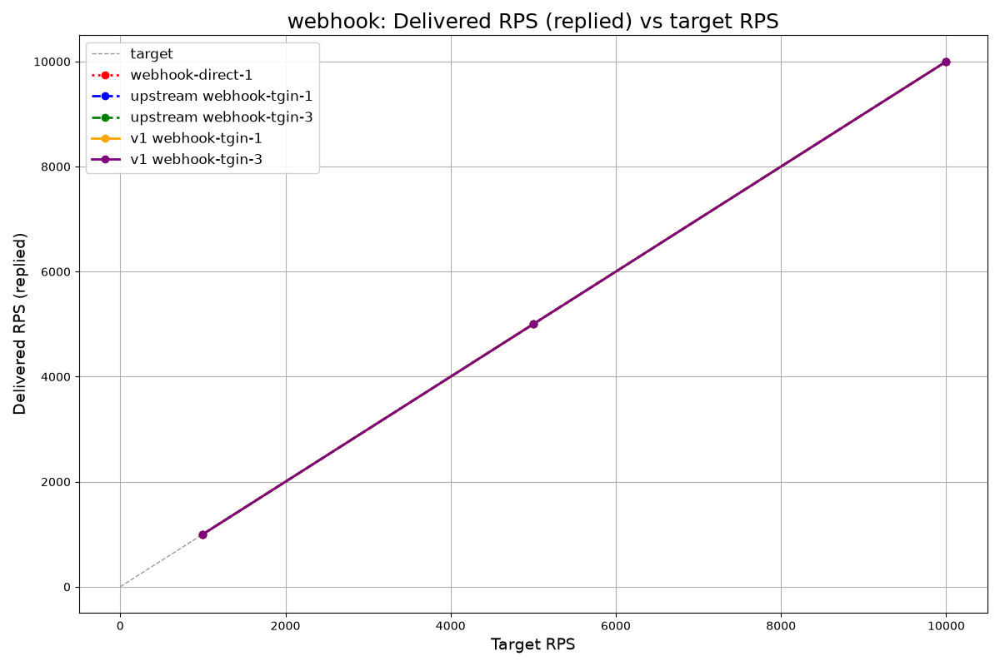</td>
    <td>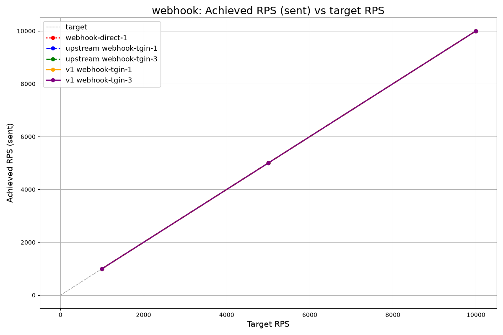</td>
  </tr>
  <tr>
    <td>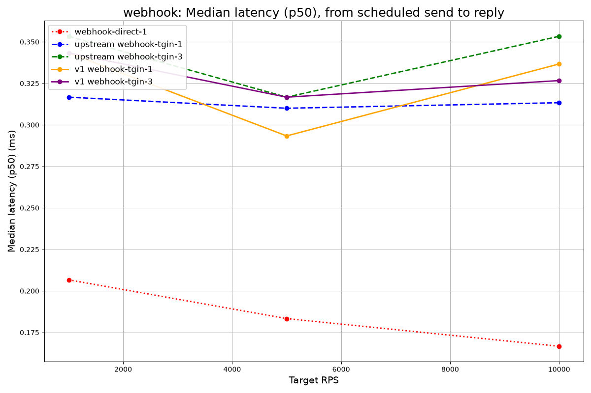</td>
    <td>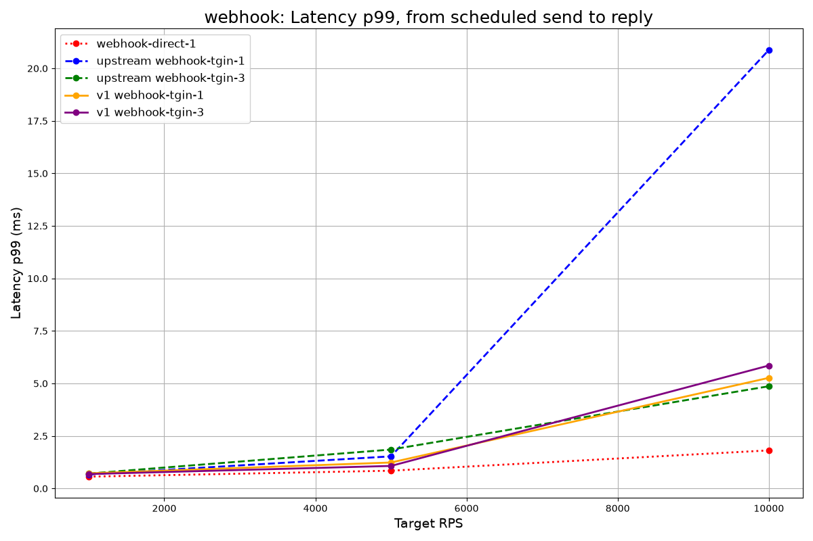</td>
  </tr>
  <tr>
    <td>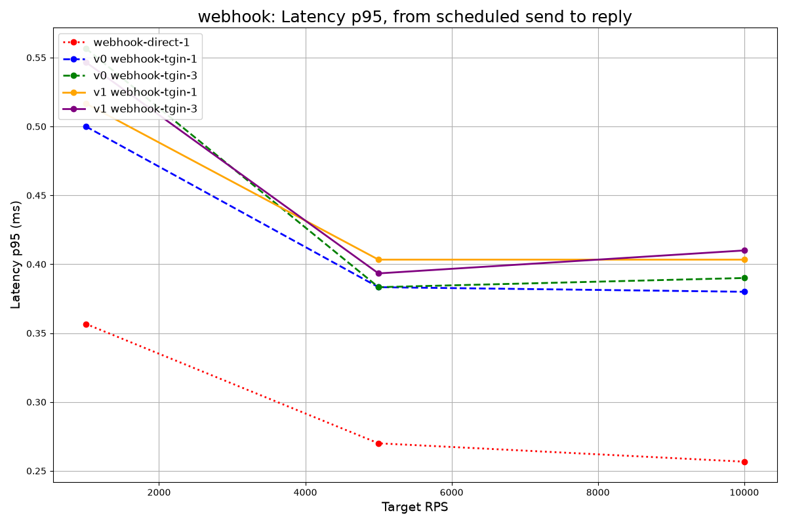</td>
    <td>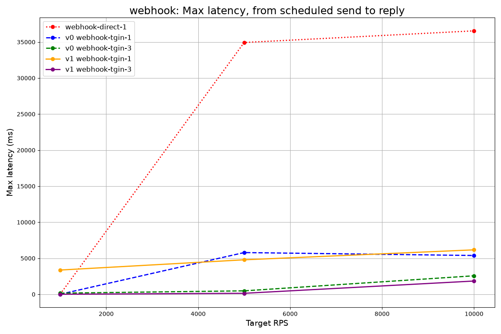</td>
  </tr>
  <tr>
    <td>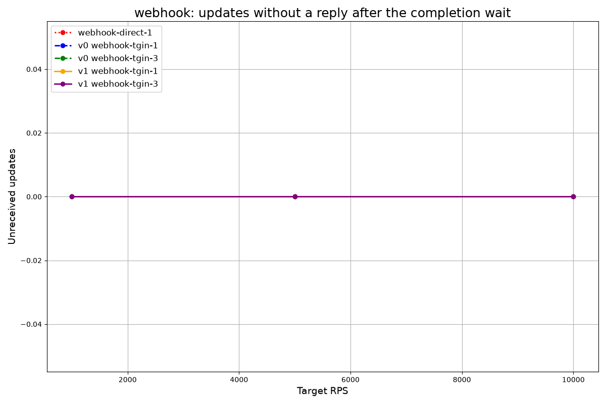</td>
    <td></td>
  </tr>
</table>

### Long poll

<table>
  <tr>
    <td>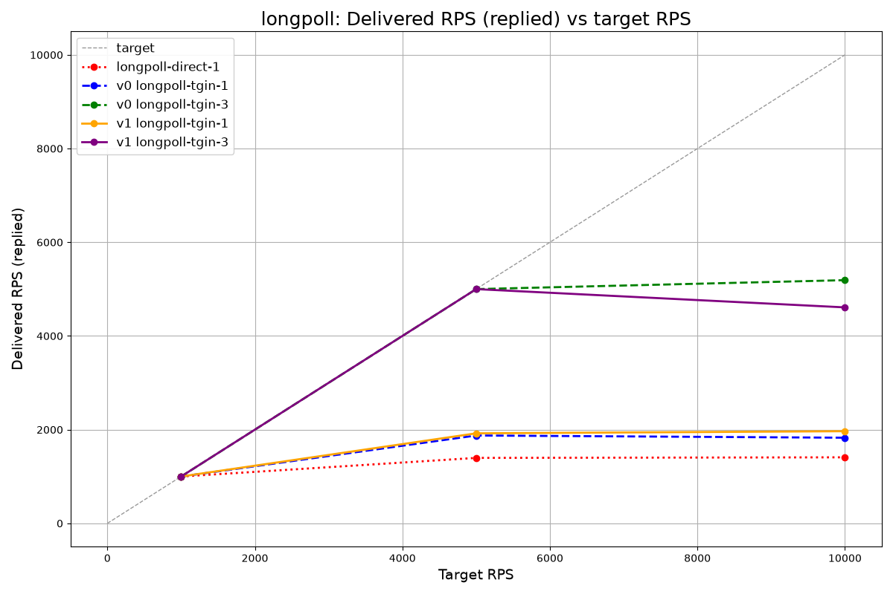</td>
    <td>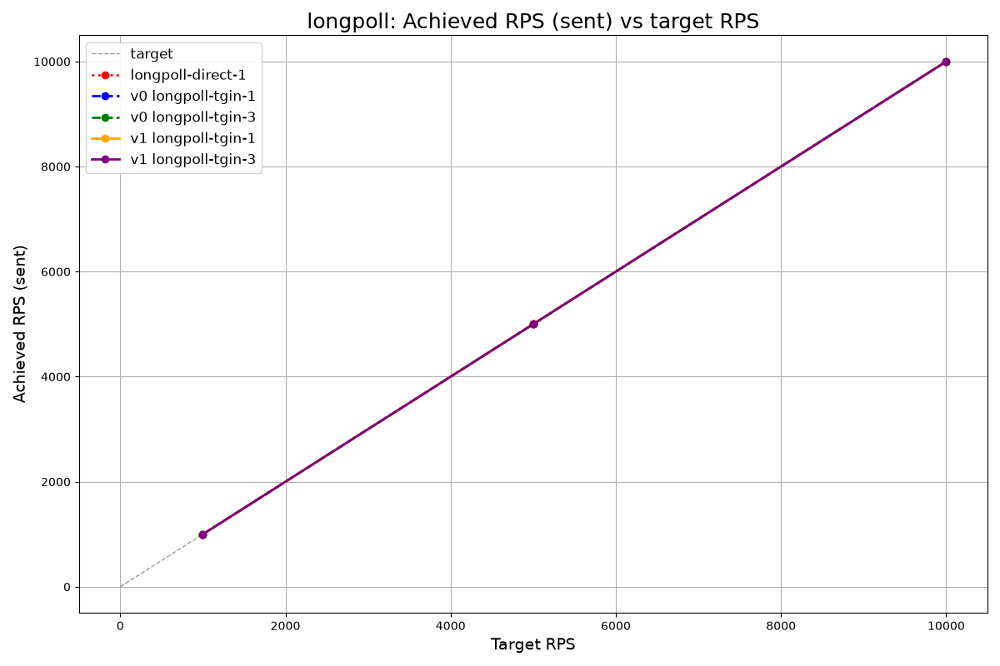</td>
  </tr>
  <tr>
    <td>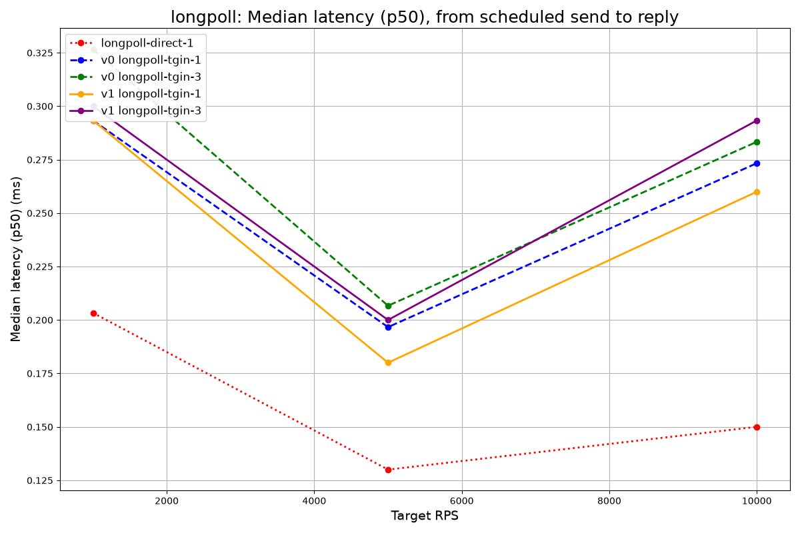</td>
    <td>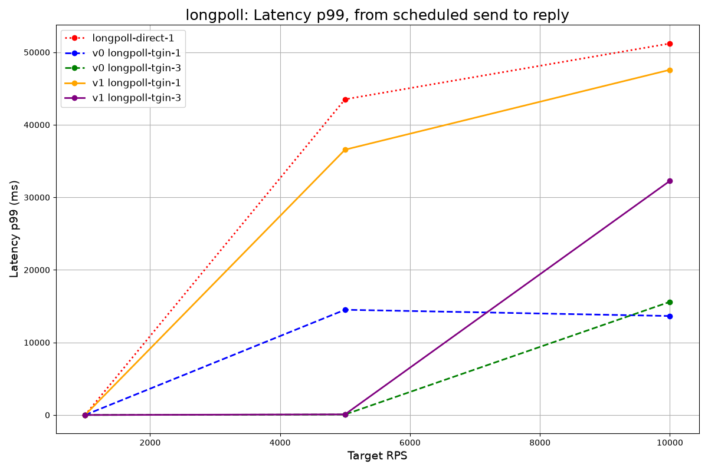</td>
  </tr>
  <tr>
    <td></td>
    <td>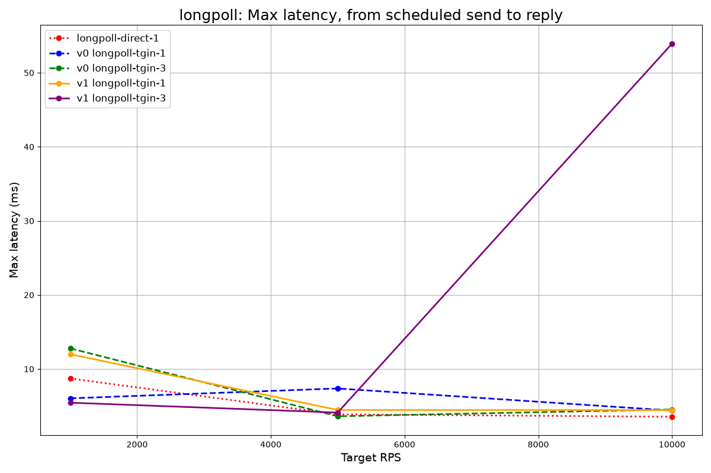</td>
  </tr>
  <tr>
    <td>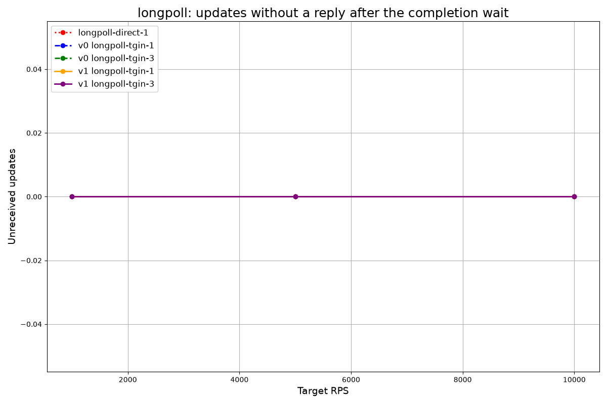</td>
    <td></td>
  </tr>
</table>

## What changed for performance

Each item was checked in both codebases. Paths starting with `src/` are files of the original engine at `4f0971a` (`git show 4f0971a:<path>`); paths starting with `crates/` are files of this tree.

1. **Updates stay bytes; no JSON tree on the hot path.** The original engine parses each `getUpdates` answer into a `serde_json::Value` (`src/update/longpull.rs:62`), deep-copies every update into its channel (`update.clone()`, `:68`), and parses webhook bodies into a `Value` with axum's `Json` extractor (`src/update/webhook.rs:121-123`). It queues `Value`s (`src/route/longpull.rs:27`) and serializes them again on the way out (`src/route/longpull.rs:66-69`, `src/route/webhook.rs:27`). tgin 1.0 copies a `getUpdates` body once into `Bytes` (`crates/tgin-botapi/src/client.rs:191`), splits it into sub-slices without copying (`client.rs:338-346`), and reads a webhook body once, to its exact size (`crates/tgin-botapi/src/webhook.rs:343-377`). It reads the routing facts in one borrowed pass, with no `Value` (`crates/tgin-botapi/src/facts.rs:1`). It forwards the original bytes: a push delivery sends the queued `Bytes` (`crates/tgin-core/src/consumer/push.rs:480`), and a pull response is written as chunks around the raw payloads, without copying them (`crates/tgin/src/data_server.rs:481-499`).
2. **An allocation budget.** Splitting a `getUpdates` body, extracting facts and admitting an update into the engine allocates at most twice per update once warm. `crates/tgin-botapi/tests/alloc_budget.rs` enforces this (`BUDGET_PER_UPDATE`, line 75) on two fixtures and measures, on this tree (`cargo test -p tgin-botapi --test alloc_budget -- --nocapture`), 1.559 allocations per update on the ASCII-heavy one ("1559 allocations for 1000 updates") and 1.563 on the same updates with every text, caption and callback data non-ASCII, which Telegram sends `\u`-escaped ("1563 allocations for 1000 updates"). Escaped text is decoded into one buffer per `getUpdates` batch rather than into an allocation per update; before that change the escaped fixture took 2.401. The original engine has no such bound; per update it allocates at least the `Value` tree and its deep copy.
3. **Routing reads one atomic snapshot.** The original engine takes an async `RwLock` read in each load balancer for every update (`src/lb/roundrobin.rs:36`, `src/lb/all.rs:30`). Each poll of a route added through the API also reads a global `std::sync::RwLock` map (`src/dynamic/longpoll_registry.rs:7`, `src/dynamic/handler.rs:64`). tgin 1.0 keeps its routing state in an `ArcSwap` and loads it once per update (`crates/tgin-core/src/engine.rs:4-7`, `crates/tgin-core/src/admission.rs:31`). The data plane's router sits behind an `ArcSwap<Router>` that reloads replace (`crates/tgin/src/data_server.rs:68, 228-233`).
4. **No task per update.** The original engine spawns a task per update (`src/tgin.rs:143, 180`), and its `AllLB` one more per route per update (`src/lb/all.rs:35`); each webhook delivery waits inside its task, with no bound on how many run at once. tgin 1.0 admits an update inline in the source or webhook handler (`crates/tgin-botapi/src/webhook.rs:227`). A push consumer has one dispatcher task with at most `max_in_flight` (default 32) deliveries at once (`crates/tgin-core/src/consumer/push.rs:4-5, 232-250`, `crates/tgin-core/src/config/defaults.rs:35-36`).
5. **Backpressure and leases instead of unbounded buffers.** The original engine:
   - buffers in a channel of 1 000 000 (`src/tgin.rs:81`) and an unbounded queue per long-poll route (`src/route/longpull.rs:27, 88-91`);
   - confirms every fetched update to the Bot API at once (`offset = id + 1`, `src/update/longpull.rs:66-67`);
   - removes an update from the queue when it hands it out (`src/route/longpull.rs:59`);
   - answers a webhook `200` once the update is queued (`src/update/webhook.rs:135-136`);
   - ignores delivery errors (`src/route/webhook.rs:27`).

   tgin 1.0:
   - bounds each consumer's queue (`capacity` 10 000, `capacity_bytes` 64 MiB, `crates/tgin-core/src/config/defaults.rs:43-48`);
   - on a full queue, holds the long-poll batch without moving the offset (`crates/tgin-botapi/src/longpoll.rs:318-333`), or answers a webhook `503` with `Retry-After` (`crates/tgin-botapi/src/webhook.rs:251-264`);
   - leases pulled updates until the next `offset` acknowledges them ([DOCS.md → Pull consumers](DOCS.md#pull-consumers-the-getupdates-endpoint)).

   [Overload](#overload) shows the effect.
6. **The long-poll source polls again at once.** The original engine sleeps `default_timeout_sleep` after every answer (`src/update/longpull.rs:74`; 100 ms by default, 0 in the benchmark configs). tgin 1.0's source polls again immediately and sleeps only after an error or while its sink is full (`crates/tgin-botapi/src/longpoll.rs:287, 329`). In the matrix, the original engine made about 700–880 calls per second and tgin 1.0 up to 7 500.
7. **`TCP_NODELAY`.** The original engine serves with `axum::serve` and does not set `TCP_NODELAY` (`src/tgin.rs:123-124`; axum 0.7.9 leaves it unset unless asked), so Nagle's algorithm stays on. Each of its responses is one body. tgin 1.0 writes a pull response as one chunk per update and sets `TCP_NODELAY` on every accepted connection (`crates/tgin-runtime/src/http/accept.rs:47`); see [below](#two-problems-found-while-measuring-tgin-10) for why.
8. **mimalloc on musl.** The original image is a glibc Debian build with the system allocator (its `Dockerfile`). tgin 1.0's static musl builds, including the container image, use mimalloc as the global allocator (`crates/tgin/src/main.rs:5-7`, `crates/tgin/Cargo.toml:36-37`).
9. **Connection cap and timeouts.** The original engine sets no connection limit and no header timeout on its listener (`src/tgin.rs:123-124`). Its HTTP clients are `reqwest::Client::new()` with no timeouts (`src/route/webhook.rs:14`, `src/update/longpull.rs:24`). tgin 1.0 caps a listener at `server.max_connections` (10 000) and gives clients `server.header_read_timeout` (10 s) to send a request head (`crates/tgin-runtime/src/http/server.rs:43-54, 215-223`). It bounds a webhook request to 30 s (`crates/tgin/src/data_server.rs:41, 250-258`), and its outgoing requests to 5 s to connect and 10 s in total (`crates/tgin-runtime/src/http/client.rs:33-34`; push endpoints `timeout` 10 s, `crates/tgin-core/src/config/defaults.rs:55-56`).

## Two problems found while measuring tgin 1.0

**1. Nagle's algorithm on tgin's data plane (engine fix).** A pull response is written as one chunk per update, so a batch leaves tgin as several writes. With Nagle's algorithm on, every write after the first waits for the client's delayed ACK, up to 40 ms on Linux. Before the fix, `longpoll-tgin-1` at 10 000 RPS had p99 77.50, 472.06 and 88.06 ms ([`20261015T2215Z-lp1-diag-v1`](tests/performance/results/20261015T2215Z-lp1-diag-v1.csv)). An instrumented build showed nothing slow inside tgin: not the `getUpdates` poll, the admission, the lease or the handler ([`…-instrumented`](tests/performance/results/20261015T2225Z-lp1-diag-instrumented-v1.csv), p99 52.51 ms). A packet capture showed the delay sitting between two segments of one response. tgin now sets `TCP_NODELAY` on every accepted connection. The same instrumented build then measured p99 0.69, 0.72 and 0.84 ms at that point ([`…-nodelay-instrumented`](tests/performance/results/20261015T2235Z-lp1-diag-nodelay-instrumented-v1.csv)), and the release image 0.86 ms in [Results](#results).

**2. Unbounded webhook connections in the generator (harness fix).** Telegram opens at most `max_connections` (≤ 100) connections to a webhook; the generator opened one per in-flight send, up to 10 000. In the sets taken before the cap ([`20261015T2107Z-rust`](tests/performance/results/20261015T2107Z-rust.csv), [`20261015T2245Z-rust-nodelay`](tests/performance/results/20261015T2245Z-rust-nodelay.csv)), tgin 1.0's webhook points had valid runs with p99 of 41.53, 48.26, 49.79 and 93.31 ms, and `webhook-direct-1`, with no tgin, one of 161.15 ms. Older sets keep only the 1.0 and direct rows used here; their direct rows carry the label `v1`, which names no engine, as no tgin is in their path. Kernel counters read from each container's network namespace (`/proc/net/snmp` and `/proc/net/netstat`) after runs of `webhook-tgin-1` at 10 000 RPS show the cause. In tgin 1.0's outlier run (p99 98.43 ms):
- the **generator's** namespace had `TcpActiveOpens` 3 583 and `TcpExtTCPSynRetrans` 2 393;
- **tgin's** namespace had `TcpExtListenOverflows` 3 004 and `TcpExtTCPSynRetrans` 130 (SYN-ACK retransmits).

Runs without outliers had no overflows and no retransmits in any namespace. So the generator opened thousands of connections at once, tgin's listen backlog overflowed, and the sends waited out a SYN retransmit. These counter snapshots are **unsaved diagnostics**: they were read during the investigation and are not committed. The generator now keeps at most 100 requests on the wire. The rest of the in-flight budget waits for a connection, and the wait counts in latency.

## `max_in_flight`

A push consumer's `max_in_flight` (requests in flight over all its endpoints) stays at its default, **32**, in the scenario configs. With the Rust bots and the default, tgin 1.0's webhook points in a dedicated set ([`20261016T0131Z-rust-mif32`](tests/performance/results/20261016T0131Z-rust-mif32.csv), which keeps only its 1.0 rows; 3 runs each, all valid) had these p99s:

| Point | RPS | 1.0 p99 of each run | median |
|---|---:|---|---:|
| webhook-tgin-1 | 5 000 | 0.51, 0.48, 0.46 ms | 0.48 ms |
| webhook-tgin-1 | 10 000 | 0.54, 0.69, 0.54 ms | 0.54 ms |
| webhook-tgin-3 | 5 000 | 0.65, 0.51, 44.48 ms | 0.65 ms |
| webhook-tgin-3 | 10 000 | 1.36, 0.61, 0.62 ms | 0.62 ms |

Every update was delivered in every run.

With a **single-process** downstream (one aiogram bot) at 5 000 RPS, the value mattered a great deal. These sets come from an earlier session, before the generator's 100-connection cap, so they are not comparable with the 1 474–1 561 per second of the [overload](#overload) set. Medians of tgin 1.0's `delivered_rps`:
- 256: 1 651 ([`20261015T1945Z-py-mif256-v1`](tests/performance/results/20261015T1945Z-py-mif256-v1.csv), 3 runs);
- 64: 1 781 ([`20261015T1955Z-py-mif64-v1`](tests/performance/results/20261015T1955Z-py-mif64-v1.csv), 2 runs);
- 32 (the default): 1 809 ([`20261015T1752Z-v1`](tests/performance/results/20261015T1752Z-v1.csv), 3 runs);
- 8: 2 280 ([`20261015T1955Z-py-mif8-v1`](tests/performance/results/20261015T1955Z-py-mif8-v1.csv), 2 runs) and 2 268 ([`20261015T2005Z-webhook-mif-v1`](tests/performance/results/20261015T2005Z-webhook-mif-v1.csv), 3 runs).

A bot that handles one request at a time is fastest with few requests in flight; tune `max_in_flight` to what the downstream can actually overlap.

## Pull wake-ups with competing instances

Each commit to a pull consumer's queue wakes every parked poll (`notify_waiters`), so with several bot instances polling one consumer most wake-ups find nothing to lease. Before changing that, the cost was measured at `longpoll-tgin-3`, 10 000 RPS, Rust bots, on 2026-10-16, with the threshold set in advance: change the wake-up only if empty wake-ups cost at least 5 % of tgin's CPU.

**Method.** Two throwaway builds of this tree, both with counters in `PullConsumer::poll` (wake-ups, and empty wake-ups whose lease returned nothing): **A**, the code as it is, and **B**, a prototype that wakes one waiter per newly leasable item, and none while a woken waiter has not leased yet. The CPU of tgin is the change in `/proc/1/stat` utime + stime and in the summed `/proc/1/task/*/schedstat` of the tgin process, read from a container in its PID namespace right before and after each `tgin-bench run` (the two agree within 0.01 s); CPU per update divides it by the updates sent. A and B ran interleaved, alternating which went first, 30 s per run.

| `longpoll-tgin-3`, 10 000 RPS | A (current) | B (prototype) |
|---|---:|---:|
| Empty wake-ups per update | 0.809 | 0.072 |
| tgin CPU per update, median of 5 | 118.02 µs (117.61–118.22) | 114.93 µs (114.41–115.14), −2.6 % |
| p99, median of 5 | 0.73 ms | 0.71 ms |

Removing 0.74 empty wake-ups per update saved 3.1 µs, about 4.2 µs per empty wake-up, so all of them together cost about 3.4 µs per update: **about 2.9 % of tgin's CPU**. At 5 000 RPS the set was noisy: A 179.72 µs per update (median of 3, 1.70 empty wake-ups per update), B 175.62 µs (169.88 and 181.37, 0.07 empty wake-ups per update); B's third run was invalid (`lag_p99_ms` 1.44) and is left out. `longpoll-tgin-1` at 10 000 RPS has no empty wake-ups and shows no difference (92.49 against 92.96 µs). Every run answered every update.

**Decision:** below the 5 % threshold, so commits still wake every parked poll.

## Per-update copies of long-poll updates

A queued long-poll update is a slice of its `getUpdates` response, so a consumer that keeps a few updates of each response keeps whole responses alive: up to `limit` × its `capacity_bytes` ([DOCS.md → Delivery semantics](DOCS.md#delivery-semantics)). Copying each update out of its response would make `capacity_bytes` exact. The rule, set before measuring: copy only if both allocation fixtures stay at or under 2.0 per update, tgin's CPU per update at `longpoll-tgin-1` and `longpoll-tgin-3` (10 000 RPS, Rust bots, median of 5 runs per build, builds interleaved) rises by less than 5 %, and the median p99 stays within 1.2× of slicing's. Two throwaway builds of this tree ran on 2026-10-17, CPU read from `/proc` as in the previous section: slicing as it is, and a prototype that copies each update into its own `Bytes` and drops the copy of the whole response, which the per-update copies make redundant. All 20 runs were valid (`lag_p99_ms` at most 0.23) and answered every update. CPU per update: `longpoll-tgin-1` 99.08 µs (98.14–100.03) slicing against 98.78 µs (97.09–99.30) copying, −0.3 %; `longpoll-tgin-3` 126.66 µs (125.90–127.49) against 126.35 µs (125.87–126.60), −0.2 %. Median p99: 0.60 against 0.59 ms, and 0.58 against 0.55 ms. Copying costs no measurable CPU or latency, but it adds two allocations per update (the copy, and the reference count `Bytes` allocates on the copy's first clone): the allocation gate measures 3.559 per update on the ASCII fixture and 3.563 on the escaped one, over the budget of 2. **Decision:** slicing stays, and the `limit` × `capacity_bytes` bound stays documented.

## Known limits of the harness

- **Generator CPU.** The send loop spins one core from about 500 RPS up, and the generator container uses about 2–3 cores at 5 000–10 000 RPS. It shares the host with tgin and the bots, so a host stall shows up as generator lag; runs above 0.5 ms of `lag_p99_ms` are invalid and are rerun.
- **Long-poll `achieved_rps`** is always the target: a long-poll send only appends to the fake API's queue.
- **`delivered_rps` under overload** is computed up to the last answer, which may come during the 30 s completion wait, so an engine that keeps and later delivers a backlog can report a lower rate than one that loses it. Read it together with `unreceived`.
- **Webhook connections are capped at 100** (see above). A target that answers more slowly than 100 concurrent requests allow will show the wait in its latency rather than in `dropped_by_generator`.
- **Different engine setups.** The original engine runs with its own benchmark configs (6 worker threads) and its own image (glibc, system allocator); tgin 1.0 runs one worker per CPU in a static musl image with mimalloc. Each engine is measured as its own project builds and configures it.
- **Stopping the bench container.** Its PID 1 (`tgin-bench serve`) has no SIGTERM handler, so `docker stop` and `make clean` wait for the stop timeout before killing it.
- **Ctrl-C through `docker compose exec -T`** (as the makefile runs `tgin-bench run`) may not reach the client, so an interrupted run can keep sending until its duration ends.
- Latency is measured over the Docker bridge on a desktop OS. Differences below about 0.05 ms between engines are noise.

## Reproducing the benchmarks

Requires Docker with Compose, `make`, `curl`, `git` and `bash`; the charts need [uv](https://docs.astral.sh/uv/). One pass of the matrix over both engines (6 scenarios × 3 rates × 3 runs of 30 s, plus start-up per run) takes about 70 minutes.

```bash
cd tests/performance

# Both engines, alternating run by run → results/<run_id>.{csv,log,stats.log}
ENGINE="upstream v1" RUN_ID=mine ./benchmark.sh

# Rerun the runs whose generator fell behind (lag_p99_ms > 0.5)
./rerun-invalid.sh results/mine.csv

# The overload set: the aiogram bots at 5 000 RPS
ENGINE="upstream v1" BOT_IMPL=py RPS_VALUES=5000 SCENARIOS="longpoll-tgin-1 webhook-tgin-1" RUN_ID=mine-py ./benchmark.sh

# One point (ENGINE=v1 and BOT_IMPL=rust are the defaults)
make webhook-tgin-3 RPS=10000 DURATION=30
make longpoll-tgin-3 ENGINE=upstream RPS=1000 DURATION=30

# Charts into diagram/generated/ (several CSVs may be combined)
cd diagram
uv run main.py ../results/mine.csv
```

`benchmark.sh` takes `ENGINE`, `BOT_IMPL`, `RPS_VALUES`, `SCENARIOS`, `DURATION`, `RUNS`, `RUN_ID`, `RESULT_DIR` and `BOT_SLEEP_MS`; see its header. The makefile takes `UPSTREAM_REF` (default `4f0971a`), `V1_IMAGE` and `UPSTREAM_IMAGE`. Without CSV arguments the plotter renders the `results/*.csv` whose run id sorts last.
