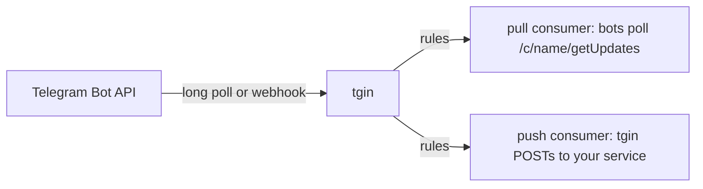

# tgin

```text
 __                          
/\ \__         __            
\ \ ,_\    __ /\_\    ___    
 \ \ \/  /'_ `\/\ \ /' _ `\  
  \ \ \_/\ \L\ \ \ \/\ \/\ \ 
   \ \__\ \____ \ \_\ \_\ \_\
    \/__/\/___L\ \/_/\/_/\/_/
           /\____/           
           \_/__/
```

<p align="center"><strong>tgin</strong> <em>— a dedicated infrastructure layer for highly loaded Telegram bots.</em><br>Think NGINX, but for the Telegram Bot API.</p>

<p align="center">
  
  <a href="https://github.com/arynyklas/tgin/releases"></a>
  <a href="DOCS.md"></a>
  <a href="PERF.md"></a>
</p>

tgin receives your Telegram bots' updates — by long polling the Bot API or as webhooks — and routes each one, by rules you write, to the processes that handle it: bot instances that poll tgin the way they would poll Telegram, or HTTP services tgin posts to.

> [!IMPORTANT]
> This is tgin 1.0 in development (`1.0.0-dev`). There is no stable release yet: 1.0 will be the first.

## Origin

tgin began as a fork of [chesnokpeter/tgin](https://github.com/chesnokpeter/tgin) by Peter Chesnokov, whose idea it is: an NGINX-like router that sits in front of Telegram bots and distributes their updates across bot instances. This project rewrote the engine for delivery guarantees (bounded queues with backpressure, leases, retries) and for performance; [Performance](#performance) shows the numbers.

## Contents

- [Origin](#origin)
- [What it does](#what-it-does)
- [Quick start](#quick-start)
- [Documentation](#documentation)
- [Performance](#performance)
- [Roadmap](#roadmap)
- [Goal](#goal)

## What it does



- **Many bots, one process.** Each bot has its own token, ingress (long poll or webhook) and rules.
- **Rules.** Route by update type, chat, chat type, user, command, text or callback data; send an update to one consumer, to several, or to one of a group (round robin, sticky by chat, or weighted).
- **Pull consumers** speak Telegram's `getUpdates`, so most frameworks only need a different URL. Updates are leased and acknowledged by `offset`; one lost by a crashed bot instance goes to another after its lease times out.
- **Push consumers** post each update to HTTP endpoints with retries, backoff, per-endpoint circuit breakers and optional per-chat ordering.
- **Bounded queues** per consumer, with backpressure to the source or dropping the oldest updates, your choice per consumer.
- **Hot reload** of the config file on change, `SIGHUP` or the admin API; only bots whose token, URL or ingress changed restart.
- **Operations.** An admin plane with `/livez`, `/readyz`, Prometheus `/metrics` and the admin API (`tgin admin` on the command line), JSON logs with secrets masked, and a graceful drain on shutdown.

Delivery is at least once while the process lives: queues are in memory, so a crash loses what they hold ([DOCS.md → Delivery semantics](DOCS.md#delivery-semantics)).

## Quick start

### Binary

Building needs Rust 1.89 or newer and a C compiler (for `aws-lc-sys`, the TLS crypto backend).

```bash
git clone https://github.com/arynyklas/tgin.git
cd tgin
cargo build --release -p tgin
```

The repository's [`tgin.yaml`](tgin.yaml) polls one bot and hands its updates to the pull consumer `bots`:

```yaml
version: 1

server:
  listen: ["0.0.0.0:8080"]

bots:
  - name: main
    token: ${env:TOKEN}
    ingress:
      long_poll: {}
    routes:
      - to: [bots]

consumers:
  bots:
    pull: {}
```

```bash
./target/release/tgin config validate tgin.yaml   # every ${env:…} must be set
TOKEN=123456:ABC ./target/release/tgin            # reads ./tgin.yaml
```

Point your bot instances' `getUpdates` at `http://127.0.0.1:8080/c/bots/getUpdates` instead of Telegram; they share the updates. The admin plane listens on `127.0.0.1:9090`:

```bash
./target/release/tgin admin status
curl -s http://127.0.0.1:9090/readyz
```

### Docker

```bash
docker build -t tgin .
# tgin.yaml lives in ./config: mount the directory, so edits reach the container
docker run -d --name tgin -p 8080:8080 \
  -v "$PWD/config:/etc/tgin:ro" \
  -e TOKEN=123456:ABC --stop-timeout 30 tgin
docker exec tgin tgin admin status
```

The image runs as uid `65532` with no shell (the mounted config must be readable by that uid), reads `/etc/tgin/tgin.yaml`, and checks its own health with `tgin admin health`. [examples/simple](examples/simple) is a Compose stack with pull and push consumers; [DOCS.md → Deployment](DOCS.md#deployment) covers Docker secrets, Kubernetes probes and binaries for Windows, macOS and Linux.

Releases carry archives for Linux (glibc and static musl), macOS and Windows on x86_64 and aarch64, shell and PowerShell installers, checksums and a CycloneDX SBOM, and the image is published as `ghcr.io/arynyklas/tgin` for `linux/amd64` and `linux/arm64`; [SECURITY.md](SECURITY.md#verifying-releases) shows how to verify them.

## Documentation

- [DOCS.md](DOCS.md) — concepts, configuration, delivery semantics, hot reload, admin API, metrics, security, shutdown and deployment.
- [docs/config-reference.md](docs/config-reference.md) — every config key, generated from the config model.
- [PERF.md](PERF.md) — benchmark methodology, results and the harness's limits.
- [CHANGELOG.md](CHANGELOG.md) — changes per release, including breaking ones.
- [SECURITY.md](SECURITY.md) — supported versions, private vulnerability reporting, release verification.
- [examples/simple](examples/simple) — a Compose stack: one bot, two polling instances and one webhook service.
- [integrations/pytgin](integrations/pytgin) — an `aiogram` shim that points `getUpdates` at tgin.

## Performance

tgin 1.0 against 0.2 at 1 000, 5 000 and 10 000 updates per second, with one and three downstream bots, webhook and long poll; methodology, the full table, the raw CSVs and the harness's limits are in [PERF.md](PERF.md). Routing an update costs a fraction of a millisecond: at 10 000 RPS the median end-to-end latency through tgin is 0.24–0.28 ms and p99 0.52–0.65 ms, against 0.13–0.15 ms and 0.33–0.46 ms straight to the bot. tgin 1.0 matches 0.2 at every point (p99 between 0.88× and 1.11×, every update delivered) and uses less CPU on the long-poll path.

<table>
  <tr>
    <td></td>
    <td></td>
  </tr>
  <tr>
    <td></td>
    <td></td>
  </tr>
</table>

## Roadmap

- [ ] Complete management API
- [ ] Expanded test and performance coverage
- [x] Structured, production-grade logging
- [ ] Anti-DDoS guard
- [ ] Message-broker support
- [ ] First-class microservices patterns
- [ ] Analytics collection
- [ ] Per-bot caching layer
- [ ] Userbot support
- [ ] End-to-end bot tests

## Goal

Provide a complete infrastructure toolkit for building scalable, high-load Telegram bots with a microservices architecture and production-ready support.
