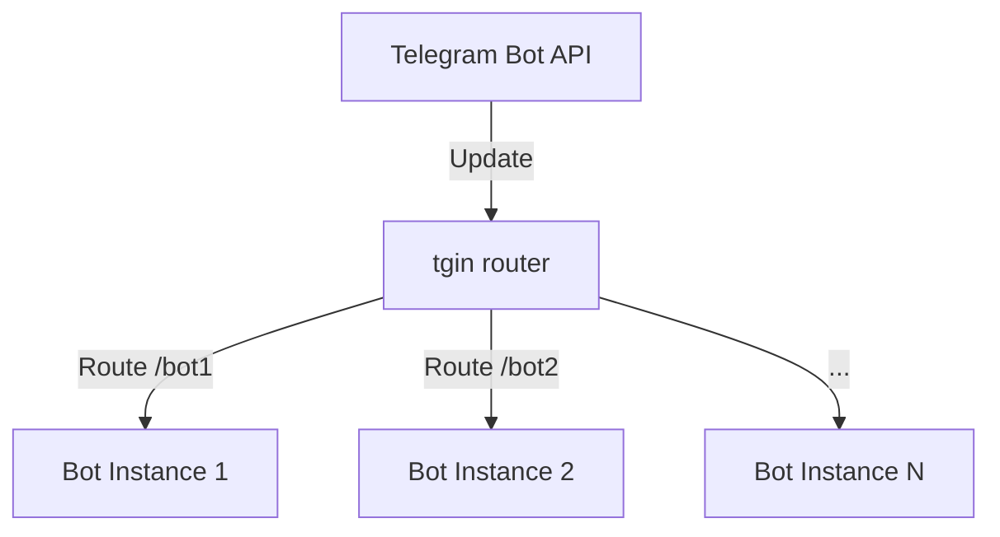

# tgin

```text
 __                          
/\ \__         __            
\ \ ,_\    __ /\_\    ___    
 \ \ \/  /'_ `\/\ \ /' _ `\  
  \ \ \_/\ \L\ \ \ \/\ \/\ \ 
   \ \__\ \____ \ \_\ \_\ \_\
    \/__/\/___L\ \/_/\/_/\/_/
           /\____/           
           \_/__/
```

<p align="center"><strong>tgin</strong> <em>— a dedicated infrastructure layer for highly loaded Telegram bots.</em><br>Think NGINX, but for the Telegram Bot API.</p>

<p align="center">
  
  <a href="https://github.com/arynyklas/tgin/releases"></a>
  <a href="DOCS.md"></a>
  <a href="PERF.md"></a>
</p>

tgin distributes incoming Telegram updates between multiple bot instances. It was built for teams scaling Telegram bots into a microservices-style deployment.

> [!IMPORTANT]
> tgin is pre-1.0 (`0.x`). Until 1.0, a minor release (`0.x.0`) may contain breaking changes; each one is listed in [CHANGELOG.md](CHANGELOG.md).

## Contents

- [Why tgin](#why-tgin)
- [Architecture](#architecture)
- [Quick start](#quick-start)
- [Documentation](#documentation)
- [Performance](#performance)
- [Roadmap](#roadmap)
- [Goal](#goal)

## Why tgin

- **Load balancing** — round-robin or broadcast updates across multiple bot instances.
- **Protocol flexibility** — long poll and webhook on both ingress and egress, in any combination.
- **Framework-agnostic** — works with any bot framework that can receive webhooks or point its `getUpdates` call at a custom URL.
- **Horizontal scaling** — add or remove downstream instances at runtime through the management API.
- **Buffering for long-poll bots** — while a long-poll downstream restarts, tgin keeps its updates in a bounded per-route buffer (`max_buffered_updates`). Webhook routes have no retries: an update sent to a webhook bot that is down is lost.
- **Microservices-friendly** — fan every update out to several specialized services with `AllLB`.
- **Operational basics** — `/livez` and `/readyz` probes, Prometheus `/metrics`, JSON logs, and a graceful drain on shutdown. There are no downstream health checks or failover yet: round-robin keeps sending a dead downstream its share.

## Architecture



Updates arrive over a long-poll or webhook ingress, traverse a tree of routes and load balancers, and land on one or more downstream bots. See [DOCS.md](DOCS.md) for the full data flow and configuration reference.

## Quick start

Building from source requires Rust 1.89 or newer (`rust-version` in `Cargo.toml`) and a C compiler for `aws-lc-sys`, the TLS crypto backend. Prebuilt binaries and a container image are described under [Install a release](#install-a-release).

### 1. Clone and build

```bash
git clone https://github.com/arynyklas/tgin.git
cd tgin
cargo build --release
```

### 2. Configure `tgin.ron`

```ron
(
    dark_threads: 6,
    server_port: Some(3000),
    updates: [
        LongPollUpdate(
            token: "${TOKEN}",
        ),
    ],
    route: RoundRobinLB(
        routes: [
            LongPollRoute(path: "/test-bot/getUpdates"),
            WebhookRoute(url: "http://127.0.0.1:8080/bot2"),
        ],
    ),
)
```

`${VAR}` placeholders are substituted from the process environment before parsing; if any are unset, tgin lists them on stderr and exits with code `1`.

### 3. Run

```bash
TOKEN=123456:ABC ./target/release/tgin -f tgin.ron
```

This config has no `api` block, so it needs no `auth_token`. The `tgin.ron` shipped in the repository enables the management API and also reads `TGIN_AUTH_TOKEN`; tgin only requires it to be non-blank, so generate a strong one, e.g. `openssl rand -hex 32`.

Or run the bundled docker-compose example:

```bash
cd examples/simple
TOKEN=... TGIN_ADMIN_TOKEN=$(openssl rand -hex 32) docker compose up --build
```

### Install a release

Each GitHub release carries archives for Linux (glibc and static musl), macOS and Windows on x86_64 and aarch64, shell and PowerShell installers, checksums and a CycloneDX SBOM. The container image is published as `ghcr.io/arynyklas/tgin` for `linux/amd64` and `linux/arm64`; see [DOCS.md → Running in Docker](DOCS.md#running-in-docker) for how to run it. Release archives and images carry build provenance attestations; [SECURITY.md](SECURITY.md#verifying-releases) shows how to verify them.

The image runs as uid/gid `65532` and contains no shell: a mounted config file (and TLS key) must be readable by uid `65532` (e.g. `chmod 0644 tgin.ron`), and health checks probe `/livez` and `/readyz` over HTTP from outside the container.

## Documentation

- [DOCS.md](DOCS.md) — configuration reference, delivery semantics, HTTP management API, observability, shutdown, Docker and TLS.
- [PERF.md](PERF.md) — benchmark methodology, charts and the known limits of the current numbers.
- [CHANGELOG.md](CHANGELOG.md) — changes per release, including breaking ones.
- [SECURITY.md](SECURITY.md) — supported versions, private vulnerability reporting, release verification.
- [examples/simple](examples/simple) — minimal docker-compose deployment with two long-poll bots and one webhook bot.
- [integrations/pytgin](integrations/pytgin) — Python `aiogram` shim that reroutes `getUpdates` through tgin.

## Performance

tgin 1.0 against 0.2 at 1 000, 5 000 and 10 000 updates per second, with one and three downstream bots, webhook and long poll; methodology, the full table, the raw CSVs and the harness's limits are in [PERF.md](PERF.md). Routing an update costs a fraction of a millisecond: at 10 000 RPS the median end-to-end latency through tgin is 0.24–0.28 ms and p99 0.52–0.65 ms, against 0.13–0.15 ms and 0.33–0.46 ms straight to the bot. tgin 1.0 matches 0.2 at every point (p99 between 0.88× and 1.11×, every update delivered) and uses less CPU on the long-poll path.

<table>
  <tr>
    <td></td>
    <td></td>
  </tr>
  <tr>
    <td></td>
    <td></td>
  </tr>
</table>

## Roadmap

- [ ] Complete management API
- [ ] Expanded test and performance coverage
- [x] Structured, production-grade logging
- [ ] Anti-DDoS guard
- [ ] Message-broker support
- [ ] First-class microservices patterns
- [ ] Analytics collection
- [ ] Per-bot caching layer
- [ ] Userbot support
- [ ] End-to-end bot tests

## Goal

Provide a complete infrastructure toolkit for building scalable, high-load Telegram bots with a microservices architecture and production-ready support.
